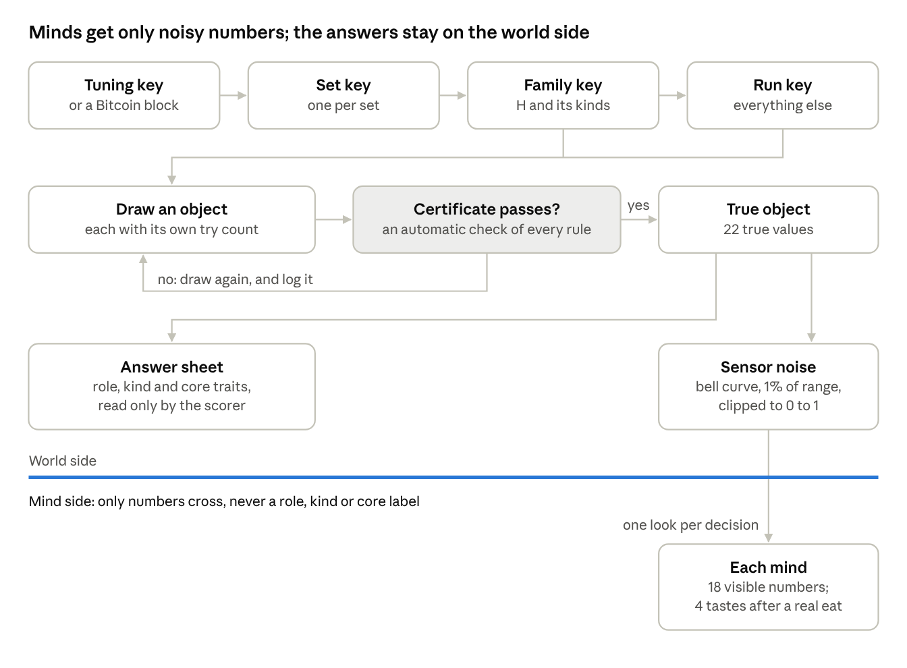

# Design note 1. Object generator

Approved by Aitzaz T as written on 25 Oct 2026, with its rows KT-30 to KT-43 in [RULES.md](../RULES.md). This is one of the four one-page design notes (I09) that [KILL_TEST.md](../../charter/KILL_TEST.md) section 11 asks for in Week 0. It works inside the frozen charter and changes none of its files.

## What it does

The generator makes every object the minds will meet. It keeps each object's true answers hidden and hands each mind only noisy numbers.

The frozen kill test already fixes most of it (KT-01 to KT-07):

- Each object is 22 numbers from 0 to 1. Eighteen can be seen, in four layers, and 4 tastes are known only after eating.
- Each kind has 4 core traits held in a narrow band: its essence. Every other trait is a free trait, which varies widely.
- A poison look-alike copies an apple's look and taste, but moves 2 of its 4 core traits.
- A key is a long number that fixes every roll of the dice. The family key draws the apple kind H, its look-alike kinds, its neutral kinds (strangers that are neither food nor poison) and the labels for H's core traits. The run key draws everything else, sensor noise included.
- Automatic checks (certificates) test every object. A failing object is drawn again, and this is logged.
- No mind is told an object's role or kind, or which traits are core; it sees the core traits' values like any others (FORBIDDEN 18). The one exception is the bot B2e, handed H's core traits on purpose to show the test can be solved. Taste arrives only after a real eat (FORBIDDEN 29).

Keys flow left to right, and every object is checked before it counts. Only noisy readings cross the line to the minds; the answer sheet stays with the scorer.

This part is world-side, not Frankie's mind. Here boring and checkable is the goal, so every option below is conventional on purpose.

## Choices

Six choices are still open. None changes a frozen rule or number.

| Open question | Textbook way | Other way | My pick |
|---|---|---|---|
| May the two teaching look-alike kinds move pairs of core traits that overlap? | Yes: any two different pairs, the plain reading of KT-04. Then in 4 of 5 families one core trait is never moved in teaching (conventional) | No: the two pairs never share a trait, so each core trait is moved by one teaching kind (conventional) | Yes, any two pairs |
| How exactly does the Bitcoin block hash become a set's key (KT-14)? | Hash the 64-character text a standard Bitcoin node shows for that block's hash (conventional) | Hash the block hash's raw 32 bytes, in the order the blockchain stores them (conventional) | The 64-character text |
| How are the dice rolled for each object? | NumPy's standard seeded generator with one running count per key, so one redraw shifts the dice of every later object (conventional) | A keyed hash chain, which mixes the key with each object's place and try number, so a redraw changes no other object's dice (conventional) | Keyed hash chain |
| What shape is the sensor noise, and can a reading leave 0 to 1? | Bell-curve noise of typical size 1%, readings clipped to 0 to 1 (conventional) | The same bell curve, not clipped; or flat noise of the same size (both conventional) | Bell curve, clipped |
| How do all minds, and both sour-apple branches, get identical noise on the same item? | Count noise draws in the order the readings happen (conventional) | Look the noise up by the item's fixed place in the run plan, and the trait (conventional) | Look up by place |
| Which practice families go into the 1,000 pretend sets of the power check, which decides how many families each kill-run set needs? | Fresh families for each pretend set; a bigger set keeps the smaller set's families (conventional) | One fixed pool of families, reused in every set (conventional) | Fresh families |

## My picks and why

- **Yes, any two pairs.** That is what KT-04 says, read plainly. Never sharing a trait would move every core trait in teaching, which probably raises K-F's odds against brute trial and error. It would add a limit KT-04 does not state, one that favours K-F, so choose it only on purpose.
- **The 64-character text.** Anyone can check it on a block explorer, a public website that shows Bitcoin blocks. It goes into the frozen bench code before any kill-run set's key exists, so nobody can choose a reading after seeing a block. The key is read once 5 more blocks sit on top of that block, which Bitcoin calls 6 confirmations.
- **Keyed hash chain.** Anyone can recompute any object from the key and its logged try number. A redraw never changes another object's dice, though an object checked against the redrawn one may need its own redraw.
- **Bell curve, clipped.** Every reading stays inside 0 to 1, as KT-01 says, so the tower's detectors, which turn readings into evidence, always respond. Unclipped readings could slightly handicap the tower minds, K-F included, if the tuned detector width is narrow.
- **Look up by place.** It is the surest way to give every mind, and both sour-apple branches, exactly the same readings of an item, as KT-16 needs.
- **Fresh families.** One reused pool would understate how much results vary between sets. The power check could then pass at too small a set size, which would cost K-F a GO it deserves.

The teaching-pair pick moves K-F's odds most. Clipping and fresh families each spare K-F a small handicap. The other picks treat every mind alike.

## Your OK

Approving this note also approves its rows KT-30 to KT-43 in [RULES.md](../RULES.md), the small fill-ins a coder needs. One is worth a glance: KT-38 counts a check kind as "in the tuning set" only if it matches a tuning kind exactly, rather than within a set distance (untested). Near-matches are rare either way. Do you approve the object generator note as written?
