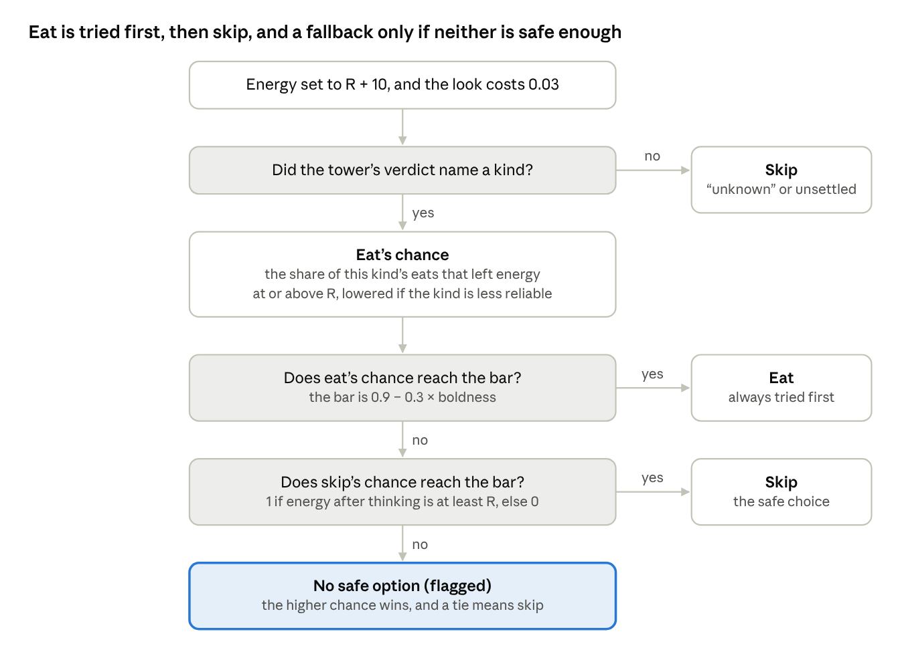

# Design note 2. Drive

Approved by Aitzaz T as written on 25 Oct 2026, with its rows KT-44 to KT-50 in [RULES.md](../RULES.md). This is one of the four one-page design notes (I09) that [KILL_TEST.md](../../charter/KILL_TEST.md) section 11 asks for in Week 0. It works inside the frozen charter and changes none of its files.

## What it does

For each object, the drive decides eat or skip. It uses the tower's verdict, the eat record of the kind that verdict names, and the mind's energy.

The frozen kill test already fixes almost all of it (section 5: KT-08, and W45 for the energy reset):

- Before every taste and every check, energy is set to R + 10, and this is logged. R, the reserve, is the level a mind tries not to fall below. R and boldness are drawn once per run, the same for every mind.
- Each eat changes energy at once: +15 if it nourishes, 0 for a "nothing", and −20 for poison.
- A verdict of "unknown", or no settled verdict (the tower never made up its mind), means skip.
- Otherwise eat is considered first. Its chance is the share of that kind's past eats that left energy at or above R, lowered if the kind is marked less reliable.
- Skip's chance is 1 if energy, after this decision's thinking cost, is still at least R. Otherwise it is 0.
- The first option whose chance reaches the bar, 0.9 − 0.3 × boldness, is taken. If neither does, the higher chance wins, flagged as "no safe option" (M47).

Read it top to bottom: eat gets the first look, skip the second, and the flagged fallback is reached only when neither clears the bar.

So while thinking costs stay under about 10 units, skip always clears the bar, and a "nothing" eat counts as safe. B1n-mind, brute force run through this same drive, therefore eats things that resemble a stored "nothing", while B1n-bot-r skips them, since bots count only gains as good. That can move the floor K-F must beat, in either direction. The charter already chose this first-good-enough rule over the textbook rule of always taking the best score (M29, M30).

## Choices

Six details are still open. All are small, and none changes a frozen rule.

| Open question | Textbook way | Other way | My pick |
|---|---|---|---|
| B1n-mind is frozen before any K-F code. How does it get the same drive as K-F? | Write the drive once for B1n-mind, then copy that file into Frankie (conventional) | Write it twice, once on each side, and test that both give the same chances and choices on a grid of inputs (conventional) | Write twice, test match |
| What counts as one "check" for the 0.001 thinking cost paid by TW7 (K-F with ordinary neurons) and capped OS01 (all layers at once)? | One candidate tested on one trait, counted again at every settling step (conventional) | Each candidate-and-trait test counted once per decision, and again only if a tower objection brings the candidate back (conventional) | Once per decision |
| If no option reaches the bar and both chances are equal, which wins? | The first in order, eat (conventional) | Skip, which risks nothing more (untested) | Skip |
| In a forced taste, when do the energy reset and the costs land? | Reset just before the eat, and skip's test takes the thinking cost off a second time, as KT-08's words literally read (untested) | Reset before the look, and each cost is taken off once (conventional) | Reset first, count once |
| What does B1n-mind pay? | Nothing, like the bots (conventional) | The 0.03 look, plus 0.001 per stored item and trait it compares (untested) | Pay like TW7 |
| How is K-F's cost per spike matched to the 0.001 per-check rule? | Equal average cost per decision (conventional) | Equal median, the middle decision's cost (untested) | Median |

## My picks and why

- **Write twice, test match.** Copying a comparison mind's file into Frankie would look like promoting a baseline into Frankie, which FORBIDDEN 26 bans. Two copies plus a strict test keep the bots frozen first and Frankie's code its own.
- **Once per decision.** The tower's inputs are steady within a decision, so each test is made once, or again if an objection brings its candidate back. Counting every step would make slow decisions cost over 10 units, so skip would fail the bar. That would hurt TW7 directly, and K-F too, because K-F's per-spike cost is matched to this count (last row). B1n-mind would not be hurt.
- **Skip.** A random pick is banned (FORBIDDEN 12). Equal chances mean eating looks no safer than going without, so skip adds no risk. This is the non-textbook pick.
- **Reset first, count once.** Section 5 calls the whole look-and-eat a "taste", so the reset comes before the look. The textbook way follows KT-08's words literally, but taking a cost off twice would be a bookkeeping slip, not a design.
- **Pay like TW7.** B1n-mind has Frankie's body and drive (X36), so it pays Frankie's costs. They stay under 1 unit, so they cannot change its choices.
- **Median.** The capped OS01 is limited by K-F's median spend, so matching medians keeps the two comparable.

Only the check-counting pick can move K-F's odds, since counting every step would lower them. Counted once per decision, thinking costs stay small, and the other picks change no choice.

One clash in the frozen text needs your OK too. PLACEHOLDER-19 and M42 want the per-spike cost to match the per-check rule, and also want thinking to be 10 to 30% of all spending. On the bench the only other cost is the 0.03 look, so the second target allows only about 3 to 13 checks per decision. The two cannot both hold. I keep the match, which the capped OS01 relies on, and set the 10 to 30% target aside on the bench.

## Your OK

Approving this note also approves its rows KT-44 to KT-50 in [RULES.md](../RULES.md), and setting the 10 to 30% target aside on the bench. Do you approve the drive note as written?
