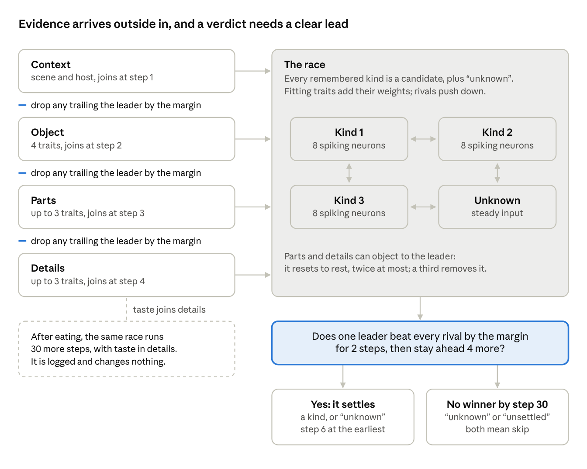

# Design note 3. Tower

Approved by Aitzaz T as written on 25 Oct 2026, with its rows KT-51 to KT-69 in [RULES.md](../RULES.md). This is one of the four one-page design notes (I09) that [KILL_TEST.md](../../charter/KILL_TEST.md) section 11 asks for in Week 0. It works inside the frozen charter and changes none of its files.

## What it does

The tower names what an object is, from one look and the current memory. Each remembered kind is a candidate, run by 8 spiking neurons (D12). Candidates push each other down and drift back to rest (M04), and an "unknown" candidate is always in the race.

Evidence arrives outside in: context (scene and host), then object, then parts, then details (M01). Each trait is read by 16 detectors spread along its scale (M18). A trait fits a candidate when a detector its reading lights sits inside that kind's stored range. The detector width, a tuned tolerance, sets how far a reading reaches. A fitting trait adds its relevance weight, how much it matters for that kind (PLACEHOLDER-01).

Outer layers drop some candidates and pick up to 3 traits each for parts and details to check (M03, PLACEHOLDER-14). Parts or details can object when the leader fits their traits badly, reopening the race at most twice (M07, M08).

A winner must lead every rival by the commit margin, a tuned minimum lead, for 2 steps, then stay ahead 4 more. The verdict has then settled. With no winner by step 30, the verdict is "unknown" if no kind leads "unknown" by the margin, which counts as settled, and "unsettled" otherwise. Both mean skip (KT-10).

Layers join one step apart, and at each of the three handovers the candidates trailing the leader drop out. A verdict counts only once one candidate holds a clear lead.

The charter already turned down the textbook ways to pick what to check, to judge similarity and to build neurons.

## Choices

Six choices are open. The first matters most: the frozen text names elimination, the heart of your idea, but never says when a candidate is dropped.

| Open question | Textbook way | Other way | My pick |
|---|---|---|---|
| When is a candidate dropped (eliminated)? | Drop any candidate with a misfit in that layer, as in elimination by aspects; or keep only the top few (both conventional) | At each layer handover, just before the next layer joins in, drop any candidate trailing the leader by the commit margin (untested) | Drop if trailing by the margin |
| When does each layer join in? | A fixed timetable: context at step 1, object at 2, parts at 3, details at 4 (conventional) | The next layer opens once the outer race has kept one leader for 2 steps (untested) | Fixed timetable |
| What does an objection do to the leader? | Bars it for the rest of the decision (conventional, as in adaptive resonance theory) | Resets it to rest, free to come back; a third objection removes it (untested) | Reset, may return |
| Whose weights choose the 3 traits that parts and details check? | A plain average over the surviving candidates (conventional) | An average weighted by how strongly each survivor fires; or each trait's top weight among survivors (both untested) | Weighted by firing |
| Is "unknown" a full rival? | No: a fixed bar the leader must clear (conventional, like a detection threshold) | Yes: 8 neurons on a steady input, pushing and pushed like any candidate (untested) | Full rival |
| How do a candidate's 8 neurons differ? | Not at all: with no noise they fire in step, as one neuron (conventional) | Each gets a different share of the input, so they fire at staggered rates (untested) | Staggered shares |

## My picks and why

- **Drop if trailing by the margin.** It reuses the tuned commit margin, so no new hand-set number enters. Elimination by aspects would let one free trait, such as an apple's colour, rule out the true kind. A shortlist size would be a number I made up. The effect on K-F's odds is unclear.
- **Fixed timetable.** It is the textbook way, on purpose. The earliest a verdict can settle is step 6, so all four layers always get their say. The other way could let a look-alike settle before its details are checked. The cost: elimination gets one step per layer, and if neurons fire slowly it may drop almost nothing, so K-F would act much like OS01 (all layers at once). Also, after any objection, the rest of that decision runs without elimination. Restarting the outside-in order would cost about 4 steps each time (untested); say if you want it.
- **Reset, may return.** It is lifelike: "that doesn't fit, look again, then give up". It rejects as firmly as the textbook bar, a little more slowly, which is a small risk to rule 1 (95% of decisions must settle).
- **Weighted by firing.** The leading guesses steer where parts and details look, as M06 intends. Memory raises the blamed traits' weights in both kinds at a split (KT-72), so all three ways steer toward those traits. The effect on K-F's odds is unclear.
- **Full rival.** "I don't know" competes like any other idea. It has its full input from step 1, while real kinds gain evidence layer by layer, so it could win too early and skip true apples. That comes from the frozen input rule, so the textbook bar carries the same risk. Tuning must guard rule 2: copies of h1 must be accepted at least 80% of the time, or the result is NO-GO.
- **Staggered shares.** Eight neurons firing as one would waste seven. Staggering should calm near-ties, which helps K-F's settle rate.

A combined risk: apples a2 to a4 often start new kinds of their own, and a later apple can fit several of them about equally. A winner must lead each by the margin, so the verdict may stall until the push-down breaks the tie. A stall that lasts ends as "unknown" or "unsettled", which lowers K-F's apple scores and settle rate. Memory's no-merge pick (note 4) feeds the same risk. The harness, the test code around the minds, logs how often it happens.

Three readings of mine in [RULES.md](../RULES.md) also need your eye:

- The detector fit is slightly stricter than the exact test used to score taste noticing, which slightly hurts K-F (KT-53).
- Only parts and details object (KT-56). A look-alike's change in roundness or lobes can then only weaken its match. That may cost K-F in the roughly 54% of families where one of those is a core trait, a group the GO rules also judge.
- FORBIDDEN 5 says a mismatch may change only memory, yet an objection changes the verdict. I read it as: a mismatch never changes an option's value or the drive's bar (KT-56).

## Your OK

Approving this note also approves its rows KT-51 to KT-69 in [RULES.md](../RULES.md). The table's first choice, written out as row KT-52, decides what "elimination" means in your tower, so it deserves your closest look. Do you approve the tower note as written?
