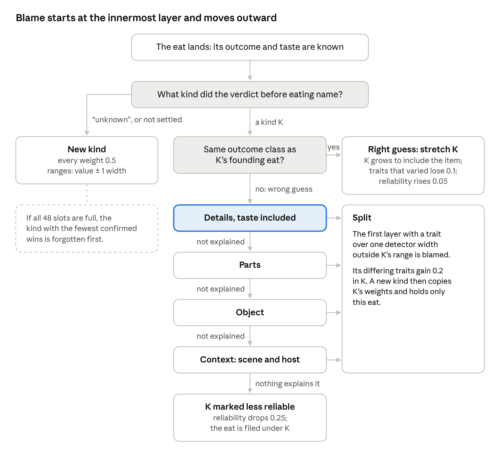

# Design note 4. Memory rule

Approved by Aitzaz T as written on 25 Oct 2026, with its rows KT-70 to KT-77 in [RULES.md](../RULES.md). This is one of the four one-page design notes (I09) that [KILL_TEST.md](../../charter/KILL_TEST.md) section 11 asks for in Week 0. It works inside the frozen charter and changes none of its files.

## What it does

After each eat, memory updates the kind (candidate) that the verdict named before eating. For every trait, taste included, a kind stores the range of values seen and a relevance weight. It also keeps its eat record and its count of confirmed wins (right guesses). Its reliability mark runs from 0 to 1 and starts at 1; a lower mark makes the drive warier of eating that kind. Memory starts empty (M09).

The frozen kill test already fixes the outline:

- **"Unknown":** a brand-new kind starts, every weight 0.5, each range the item's value plus or minus one detector width.
- **Right guess:** the kind stretches exactly to include the item. Traits that varied lose 0.1 weight (M14), and reliability rises 0.05 (PLACEHOLDER-05).
- **Wrong guess:** blame starts at the innermost layer, details (taste included), and moves outward through parts, object and context. The first layer with a trait more than one detector width outside the kind's range takes the blame. Its differing traits gain 0.2, and a new kind splits off holding only this eat (M11, M12).
- **Nothing explains it:** the kind's reliability drops 0.25 (M13).
- **Memory full (48 kinds):** the kind with the fewest confirmed wins is forgotten (PLACEHOLDER-07).

A right guess stretches the kind. A wrong guess walks the layers from details outward, and the first layer that differs takes the blame. Only when no layer explains the mistake does the kind lose reliability.

The charter chose this blame-moves-outward rule over the textbook stretch-or-split rule, which lives on only as the comparison twin TW2 (M16). TW2 uses this note's split order and line too, so it differs from K-F only in blame order and the reliability mark.

## Choices

Five choices are open, and each one changes what memory does after an eat.

| Open question | Textbook way | Other way | My pick |
|---|---|---|---|
| When does an eat's outcome "match" its kind? | Same class (gain, nothing or loss) as the eat that founded the kind (conventional, as in many category models) | Energy stayed at or above the reserve R, the drive's own test (untested) | Same class as the founding eat |
| At a split, which kind gets the +0.2? | Only the new kind; the old kind is left alone (conventional, as in adaptive resonance theory) | The guessed kind first, then the new kind copies its weights (untested) | Guessed kind, then copy |
| How far out must a trait be to count as "varied" (loses 0.1) or "differing" (gains 0.2)? | Any distance outside the stored range (conventional, as in near-miss learning) | More than one detector width outside, the same line blame uses (untested) | One detector width |
| After a mistake no layer explains, where does that eat go? | Onto the guessed kind's record, its ranges unchanged (conventional) | Nowhere; only the lower reliability remembers it (untested) | Guessed kind's record |
| Do two kinds ever merge into one? | Never; kinds only split (conventional) | Merge two kinds when a stretch makes one cover the other (untested) | Never merge |

## My picks and why

- **Same class as the founding eat.** Textbook on purpose. The drive's test would count "nothing" as food on the bench, because energy is reset to R + 10 before every taste. A kind keeps the class it was founded with. An eat of another class is a wrong guess, which splits off a new kind or, if nothing explains it, lowers reliability. This likely helps K-F against strangers, never-seen kinds that do nothing when eaten (rule 4b). It is fair, since the bots also count "nothing" as bad.
- **Guessed kind, then copy.** The plain reading of M12: the blamed layer "changes" in the guessed kind. Both kinds learn which traits mattered. This likely raises K-F's odds, and TW2 does the same, so that comparison stays fair.
- **One detector width.** One line for all three tests keeps the rule simple. The effect on K-F is mixed: fewer stray gains, but free traits lose weight less often.
- **Guessed kind's record.** Otherwise the reliability mark would do nothing, because the drive's reliability penalty acts only on a kind with a bad eat on record. It is rare, but if it hits h1's kind, that kind's apples may be skipped for the rest of the run. Only later apple eats filed under it can raise its chance again.
- **Never merge.** Textbook, because no frozen row designs a merge, and adding one would test my idea, not yours. It may lower K-F's odds. A later apple can fit the kinds started by h1 and a2 to a4 about equally, so its verdict may end "unknown" or "unsettled". That lowers K-F's scores and can hurt the settle rate (rule 1).

One reading follows from the tower note. A forced eat whose decision never settled is written as an eat judged "unknown", which starts a brand-new kind, because a verdict counts only once it settles (KT-65, PLACEHOLDER-93). It is rare, and it slightly lowers K-F's scores in those runs.

## Your OK

Approving this note also approves its rows KT-70 to KT-77 in [RULES.md](../RULES.md). The picks that move K-F's odds most are the outcome classes and where the +0.2 goes (likely help), and never merging (may hurt). Do you approve the memory note as written?
